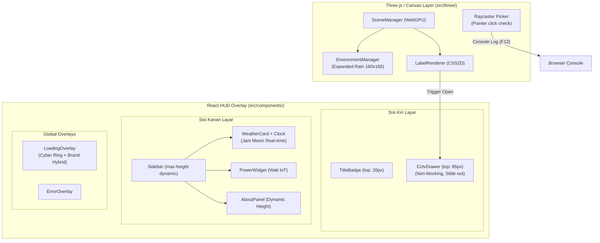

# Digital Twin Arunika — Spesifikasi Desain Peningkatan UI, CCTV Drawer, & Coordinate Picker

**Tanggal:** 2026-10-21  
**Status:** Approved by User  
**Topik:** Peningkatan Efek Hujan, Console Coordinate Picker, Dynamic Sidebar, Jam Real-Time, Non-blocking CCTV Drawer, dan Futuristic Loading Screen  
**Path:** `docs/superpowers/specs/2026-10-21-ui-enhancements-and-coord-picker-design.md`

---

## 1. Ringkasan & Latar Belakang

Setelah keberhasilan migrasi arsitektur monolitik ke Vite + React SPA (Three.js WebGPU), fase pengembangan berikutnya difokuskan pada pemolesan pengalaman pengguna (*user experience*), estetika visual, serta penyediaan alat bantu kerja (*developer tooling*) untuk pemetaan koordinat 3D.

Dokumen ini merinci 6 peningkatan spesifik yang telah disetujui:
1. **Perluasan Jangkauan Hujan (`EnvironmentManager.js`)**: Memperlebar batas area jatuh partikel hujan dari $\pm 20$ unit menjadi $160 \times 160$ unit dengan 10.000 partikel agar seluruh model fasad kantor dan halamannya tertutup hujan secara merata.
2. **Raycaster Console Coordinate Picker (`Viewport3D.jsx`)**: Menangkap klik pada objek 3D di kanvas dengan filter ambang pergeseran drag ($< 5\text{ px}$), lalu mencetak koordinat presisi $(X, Y, Z)$ ke Developer Tools Console (`F12`).
3. **Sidebar Deskripsi Dinamis (`App.css`)**: Menghilangkan properti peregangan vertikal kaku sehingga tinggi panel deskripsi mengikuti panjang teks secara dinamis.
4. **Digital Clock Real-Time (`WeatherCard.jsx`)**: Menambahkan jam digital yang diperbarui setiap detik dan sinkron dengan jam mesin lokal (format `HH:mm:ss WIB`).
5. **CCTV Slide-Out Drawer Non-Blocking (`CctvDrawer.jsx` & `App.css`)**: Menggantikan modal popup layar penuh dengan panel laci di sisi kiri (di bawah Title Badge) yang memiliki animasi slide-out, tombol tutup, dan tidak memblokir interaksi OrbitControls dengan kanvas 3D, dilengkapi video feed simulasi loop dan komentar kode panduan integrasi video stream asli.
6. **Futuristic & Brand Hybrid Loading Screen (`LoadingOverlay.jsx` & `App.css`)**: Mendesain ulang loading screen memadukan identitas brand Arunika (tipografi elegan & pulse glow) dengan elemen Cyber Digital Twin (dual rotating cyber rings, status stepper WebGPU, dan shimmer progress bar).

---

## 2. Arsitektur Komponen & Isolasi



### Prinsip Isolasi:
1. **Non-blocking Interaction**: Komponen `CctvDrawer` tidak menggunakan backdrop overlay fullscreen. Properti CSS kanvas dan OrbitControls tetap menerima pointer events secara bebas.
2. **Decoupled Picker**: Logika Raycaster Coordinate Picker bekerja di level DOM pointer event tanpa menambah render overhead pada animation loop Three.js.
3. **Centralized Configuration**: Semua konstanta ukuran hujan dan batasan partikel didefinisikan terpusat di `src/constants/config.js`.

---

## 3. Spesifikasi Detail Per Komponen

### 3.1 EnvironmentManager.js (Perluasan Hujan)
* **Masalah:** Partikel hujan sebelumnya hanya tersebar dalam rentang $X, Z \in [-20, 20]$ dan $Y \in [0, 30]$. Karena pusat model kantor berada di offset $(+10, +6, +1)$, hujan tampak seperti silinder sempit dan tidak menyentuh sayap samping gedung.
* **Solusi Desain:**
  * Sebaran posisi partikel:
    * $X = (\text{Math.random}() - 0.5) \times 160 + 10$ (rentang $-70$ hingga $+90$).
    * $Y = \text{Math.random}() \times 55 - 5$ (rentang $-5$ hingga $+50$).
    * $Z = (\text{Math.random}() - 0.5) \times 160 + 1$ (rentang $-79$ hingga $+81$).
  * Logika reset batas jatuh:
    * Jika $Y < -5$, maka $Y$ di-reset kembali ke $50$.
  * Di `src/constants/config.js`, nilai `MAX_RAIN_PARTICLES` dinaikkan dari `5000` menjadi `10000` agar partikel tetap tampak padat dan berkesan lebat di area luas.

### 3.2 Viewport3D.jsx — Raycaster Console Coordinate Picker
* **Mekanisme Anti-Drag:**
  * Merekam titik `(startX, startY)` pada event `pointerdown`.
  * Saat `pointerup`:
    * Menghitung $\Delta = \sqrt{(e.clientX - startX)^2 + (e.clientY - startY)^2}$.
    * Jika $\Delta \ge 5\text{ px}$, event diabaikan (karena pengguna sedang melakukan rotasi/panning dengan OrbitControls).
    * Jika $\Delta < 5\text{ px}$, inisialisasi Raycaster:
      ```javascript
      mouse.x = (e.clientX / window.innerWidth) * 2 - 1;
      mouse.y = -(e.clientY / window.innerHeight) * 2 + 1;
      raycaster.setFromCamera(mouse, camera);
      const hits = raycaster.intersectObjects(scene.children, true);
      ```
  * Jika ditemukan titik temu (`hits.length > 0`):
    * Titik pertama `const pt = hits[0].point`.
    * Cetak ke console dengan banner visual berlatar biru:
      ```javascript
      console.log(
        `%c📍 Picked 3D Coordinate: { x: ${pt.x.toFixed(2)}, y: ${pt.y.toFixed(2)}, z: ${pt.z.toFixed(2)} }`,
        "background: #0284c7; color: #ffffff; padding: 4px 8px; border-radius: 4px; font-weight: bold;"
      );
      console.log("Vector3 object:", pt);
      ```
  * Jika tidak ada objek yang terkena:
    * `console.log("Clicked into empty space (no object hit).");`

### 3.3 CctvDrawer.jsx — Non-Blocking Left Panel
* **Lokasi File:** `src/components/dashboard/CctvDrawer.jsx` (menggantikan `src/components/modals/CctvModal.jsx`).
* **Positioning & Layout:**
  * CSS: `position: fixed; top: 85px; left: 20px; width: 340px; z-index: 25;`
  * Animasi slide-out:
    * Tertutup: `transform: translateX(-120%); opacity: 0; pointer-events: none;`
    * Terbuka: `transform: translateX(0); opacity: 1; pointer-events: auto;`
    * Durasi: `transition: transform 0.3s cubic-bezier(0.16, 1, 0.3, 1), opacity 0.3s ease;`
* **Komponen Konten:**
  * Header: Judul Kamera (`cctvName`), indikator kedip hijau *LIVE FEED*, dan tombol tutup silang (`X`).
  * Video Viewport: Rasio 16:9 dengan overlay visual CCTV:
    * Grid crosshair sudut kamera.
    * Teks status OSD (On Screen Display): `CAM-01 [SIMULATED] | YYYY-MM-DD HH:mm:ss`.
    * Tag `<video>` simulasi loop lokal / placeholder canvas animasi.
  * Blok Komentar Panduan:
    * Penjelasan instruksi integrasi untuk HLS (m3u8), WebRTC/RTSP stream, atau MP4 URL langsung.
  * Footer: Tombol aksi tutup / switch camera.

### 3.4 WeatherCard.jsx — Digital Clock Real-Time
* **State Management:**
  * `const [currentTime, setCurrentTime] = useState(() => new Date());`
  * `useEffect` dengan interval timer 1.000 ms dan cleanup saat unmount.
* **Format:**
  * Menggunakan `toLocaleTimeString("id-ID", { hour: "2-digit", minute: "2-digit", second: "2-digit", hour12: false })` ditambah suffix `"WIB"`.
  * Menggunakan CSS `font-variant-numeric: tabular-nums` agar lebar karakter seragam saat detik berganti.
* **Tampilan:**
  * Menampilkan ikon `Clock` dari `lucide-react` bersanding dengan teks jam di baris atas kartu cuaca.

### 3.5 App.css & Sidebar.jsx — Dynamic Sidebar Height
* **Penyesuaian CSS:**
  * `.sidebar-container`: hapus `bottom: 20px`, gunakan `max-height: calc(100vh - 40px);`.
  * `.sidebar-panel-bottom`: hapus `flex: 1; overflow-y: auto;`.
  * Hasil: Panel atas (Cuaca & Daya) dan panel bawah (Tentang Aplikasi) membungkus teksnya masing-masing secara natural tanpa ruang kosong yang memanjang ke dasar layar.

### 3.6 LoadingOverlay.jsx — Futuristic & Brand Hybrid
* **Konsep Visual:**
  * **Brand Aura:** Tipografi elegan judul *"Arunika Office — Digital Twin"*, tag *"WebGPU Engine"*, dan latar belakang *radial dark cyan vignette*.
  * **Cyber Gyro Rings:** Dua cincin SVG/CSS berputar berlawanan arah (`@keyframes orbitClockwise` dan `@keyframes orbitCounterClockwise`) mengitari ikon kubus 3D di tengah.
  * **Glowing Number:** Persentase kemajuan berukuran besar (`font-size: 28px; font-weight: 700;`) dengan teks bergradasi `linear-gradient(135deg, #38bdf8, #818cf8)`.
  * **Shimmer Progress Bar:** Track bar kemajuan dengan efek gelombang cahaya meluncur (*shimmer wave*).
  * **Pipeline Indicator:** 3 tahap visual:
    1. `WebGPU Initialized`
    2. `SPZ Geometry Stream`
    3. `Interactive Twin Ready`

---

## 4. Rencana File (Daftar Perubahan)

| Aksi | File | Deskripsi |
| :--- | :--- | :--- |
| **Modify** | `src/constants/config.js` | Update `MAX_RAIN_PARTICLES: 10000`, tambah `RAIN_BOUNDS` |
| **Modify** | `src/three/EnvironmentManager.js` | Perluas rentang acak koordinat partikel hujan $X, Y, Z$ |
| **Modify** | `src/components/canvas/Viewport3D.jsx` | Tambahkan pointer down/up handler untuk Raycaster Console Picker |
| **Modify** | `src/components/dashboard/WeatherCard.jsx` | Tambahkan jam digital real-time dengan interval 1 detik |
| **New** | `src/components/dashboard/CctvDrawer.jsx` | Panel drawer geser kiri non-blocking dengan simulasi feed video |
| **Delete** | `src/components/modals/CctvModal.jsx` | Dihapus karena digantikan oleh `CctvDrawer.jsx` |
| **Modify** | `src/components/overlays/LoadingOverlay.jsx` | Desain ulang hybrid cyber gyro + brand minimalist |
| **Modify** | `src/App.css` | Styling CCTV drawer, sidebar height dynamic, cyber keyframes |
| **Modify** | `src/App.jsx` | Hubungkan state `isCctvOpen` ke `CctvDrawer` |

---

## 5. Rencana Pengujian & Verifikasi

1. **Automated Build Test**:
   ```powershell
   npx vite build
   ```
   Harus sukses 100% tanpa error bundling, chunking, atau CSS.
2. **Pengujian Fungsional Manual**:
   * **Hujan Luas**: Pastikan partikel hujan jatuh mengelilingi seluruh bangunan hingga halaman luar.
   * **Coordinate Picker**: Buka Developer Tools (F12) Console, klik dinding/tiang gedung. Pastikan koordinat $X, Y, Z$ tercetak. Drag/putar kamera -> pastikan tidak tercetak.
   * **CCTV Drawer**: Klik label CCTV -> drawer meluncur dari kiri bawah Title Badge. Putar kamera 3D di tengah layar -> pastikan OrbitControls tetap bisa digunakan. Klik tombol `X` -> drawer tertutup.
   * **Jam Mesin**: Pastikan jam digital di kartu cuaca berdetak setiap detik mencocokkan jam lokal komputer.
   * **Sidebar Dinamis**: Pastikan panel Tentang Aplikasi tidak meregang sampai dasar layar.
   * **Loading Screen**: Refresh browser -> amati keindahan animasi cyber ring ganda, stepper, dan shimmer bar.
